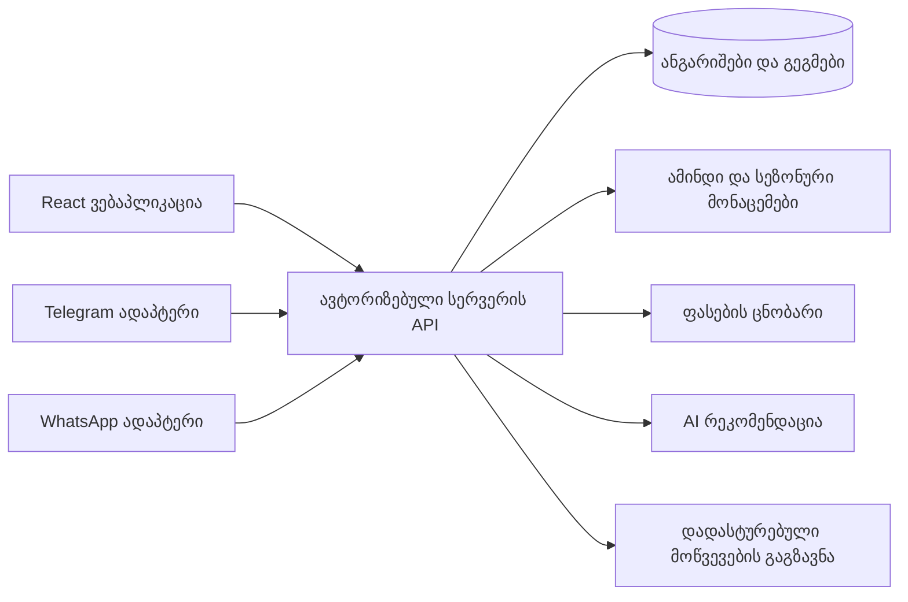

# Holliday Planner — არქიტექტურა და განვითარება

სტატუსი — შემოთავაზებული ტექნიკური გეგმა, 2026-11-10. გარე ანგარიშები და API გასაღებები დასაკავშირებელია განხორციელების ეტაპზე.

## ტექნოლოგიური არჩევანის წინადადება

| ნაწილი | არჩევანი | დანიშნულება |
| --- | --- | --- |
| ვებინტერფეისი | React + TypeScript + Vite | საგამოცდო მოთხოვნები, გვერდები და ფორმები |
| სტილები | Tailwind CSS | საერთო კომპონენტები და სხვადასხვა ეკრანის დიზაინი |
| ანგარიშები და მონაცემები | Supabase Auth + PostgreSQL | სესიები, მომხმარებლები, გეგმები და წვდომის წესები |
| სერვერის ფუნქციები | TypeScript server endpoints, განთავსების გარემოს მიხედვით | ავტორიზებული შეფასება, AI გასაღებები და მოწვევების გაგზავნა |
| AI | Gemini API-ის ანგარიშზე ხელმისაწვდომი უფასო მოდელი | მოთხოვნის ამოკითხვა და წყაროებზე დაფუძნებული რეკომენდაცია |
| AI ალტერნატივა | Groq API | პროვაიდერის შეცვლის შესაძლებლობა საჭიროებისას |
| ამინდი | Open-Meteo | ახლო პროგნოზი და ისტორიული მონაცემები |
| წერილები | Resend | მოწვევები და გაგზავნის სტატუსები |

ეს არჩევანი სამუშაო წინადადებაა. მოდელის ზუსტი ID და ლიმიტები განისაზღვრება ანგარიშში ხელმისაწვდომობის შემოწმებით. სერვერის განთავსების გარემო შეირჩევა რეალური ინტეგრაციების მოთხოვნების მიხედვით.

## საერთო მონაცემთა ნაკადი

პირველი განხორციელება მოიცავს ვებაპლიკაციას. ბოტების ინტერფეისები მოგვიანებით გამოიყენებს იმავე გეგმის შექმნის, შეფასებისა და მოწვევის ფუნქციებს.

## ძირითადი მონაცემები

| ჩანაწერი | მნიშვნელოვანი ველები |
| --- | --- |
| profile | მომხმარებლის ID, ენა, ინტერესები, ბიუჯეტის პრეფერენცია, ტრანსპორტი |
| trip | მფლობელი, ადგილი, კოორდინატები, ადგილობრივი თარიღები, დროის სარტყელი, ჯგუფის ზომა, ბიუჯეტის ერთეული, სტატუსი, ვერსია |
| assessment | გეგმის ვერსია, ამინდის მონაცემები, წყაროები, ხარჯის საფუძველი, რეკომენდაცია, მოდელი, შექმნის დრო |
| invitation | გეგმის ვერსია, მიმღები, token-ის hash, ვადა, RSVP და მისი დრო |
| notification delivery | უნიკალური გაგზავნის გასაღები, მიმწოდებლის ID, სტატუსი, ცდის დრო და შეცდომა |
| destination | აღწერა, კოორდინატები, სეზონურობა, წყარო და განახლების თარიღი |
| price reference | ადგილი, კატეგორია, მინიმუმი/მაქსიმუმი, ვალუტა, ერთეული, წყარო და შემოწმების თარიღი |

მონაწილეების რაოდენობა და უკვე შეყვანილი ელფოსტების რაოდენობა დამოუკიდებელი ველებია. ჯგუფში შეიძლება იყვნენ ბავშვები ან ადამიანები საკუთარი ელფოსტის გარეშე.

## ანგარიშები და წვდომა

- პაროლებს მართავს Auth სერვისი. აპლიკაციის ცხრილებში პაროლის ველი არ ინახება.
- მომხმარებლის გეგმებზე მოქმედებს მონაცემთა ბაზის მფლობელზე დაფუძნებული წვდომის წესები.
- სერვერი ამოწმებს სესიას, რესურსის მფლობელს, ველების სქემასა და მოთხოვნების სიხშირეს.
- AI-სა და წერილის პროვაიდერის საიდუმლო გასაღებები ინახება სერვერის გარემოში.
- AI მოთხოვნა შეიცავს საჭირო ინტერესებსა და მოგზაურობის პირობებს. მიმღების ელფოსტები რჩება მოწვევის სერვისში.
- თავისუფალი ტექსტი და გარე წყაროები მუშავდება მონაცემებად. სისტემურ მოქმედებებს მართავს ავტორიზებული სერვერის კოდი.
- მოდელის სტრუქტურირებული პასუხი მოწმდება სქემით. ვიზუალურად ნაჩვენები ტექსტი გადის უსაფრთხო რენდერს.

## შეფასების სერვისი

1. მიიღოს და გადაამოწმოს გეგმის პირობები.
2. შეინახოს გეგმა ვერსიით და გაარჩიოს ძველი და ახალი შეფასება.
3. აირჩიოს ადგილის კოორდინატები და მისი დროის სარტყელი.
4. მოაგროვოს ხელმისაწვდომი პროგნოზი ან ისტორიული სეზონური მონაცემები.
5. მოაგროვოს ხარჯების ცნობარის შესაბამისი ჩანაწერები და შეაჯამოს ხარჯები კოდით.
6. შეაფასოს სავალდებულო პირობები და მონაცემების დაფარვა.
7. გადასცეს AI-ს მონაცემთა შეკრული, პერსონალური საკონტაქტო ინფორმაციისგან დაცლილი პაკეტი.
8. გადაამოწმოს პასუხი და დაუკავშიროს წყაროების რეალური ჩანაწერები.
9. შეინახოს შეფასება მის მონაცემთა snapshot-თან ერთად.

შედეგის გადახედვისას ჩანს რომელი გეგმის ვერსია და რომელი მონაცემები შეფასდა. გეგმის შეცვლა იწვევს ხელახალი შეფასების საჭიროების ჩვენებას. ალტერნატიული ადგილისთვის ან თარიღისთვის დამოუკიდებლად გროვდება მონაცემები.

## მოწვევის სერვისი

გაგზავნა მოითხოვს ორგანიზატორის აქტიურ მოქმედებას, მიმღებების გადახედვას და კონკრეტული გეგმის ვერსიის დადასტურებას.

ერთ ტრანზაქციაში იქმნება მოწვევები და გასაგზავნი შეტყობინებების ჩანაწერები. worker ან სერვერის პროცესორი ამუშავებს გასაგზავნ რიგს. უნიკალური გასაღები ეფუძნება გეგმის ვერსიას, მიმღებსა და შეტყობინების ტიპს.

დროებითი შეცდომა იწვევს შეზღუდულ ხელახალ მცდელობას. პროვაიდერის idempotency და საკუთარი რიგის უნიკალურობა ერთობლივად ამცირებს დუბლირებას. გაურკვეველი შედეგი აღირიცხება და მოწმდება მიმწოდებელთან. გაგზავნილის და ჩაბარებულის სტატუსები ახლდება ხელმოწერის შემოწმებით მიღებული webhook-ებიდან.

თითოეული წერილი ცალკე იგზავნება. მოწვევის ბმული შეიცავს ძლიერ შემთხვევით token-ს, რომლის hash ინახება ბაზაში. ბმულს აქვს ვადა და გაუქმების შესაძლებლობა. ბმულის გახსნა აჩვენებს გეგმის შეზღუდულ გადახედვას. RSVP იცვლება მომხმარებლის აშკარა მოქმედებით. გეგმის ცვლილებისას ძველი მოწვევის ვერსია ჩანს და ახალი მოწვევა ხელახლა დასადასტურებელია.

## უფასო სერვისების პირობები

კვლევის თარიღია 2026-11-10. ანგარიშის მიმდინარე პირობები განხორციელებისას ხელახლა მოწმდება.

### Gemini

Gemini Developer API-ს აქვს უფასო დონე გარკვეული მოდელებისთვის და გამოყენების ლიმიტები. უფასო დონის კონტენტი შეიძლება გამოიყენებოდეს პროვაიდერის პროდუქტების გაუმჯობესებისთვის. განხორციელებისას მოვარგებთ მონაცემთა მინიმიზაციას, მოდელსა და მომხმარებლის ინფორმირებას არჩეული გეგმის პირობებს. [ფასები](https://ai.google.dev/gemini-api/docs/pricing) და [პირობები](https://ai.google.dev/gemini-api/terms).

### Groq

Groq-ს აქვს Free და Developer დონეები. მოდელებისა და მოთხოვნების მოქმედი ლიმიტები მოწმდება კონკრეტული ანგარიშის კონსოლში. [ანგარიშსწორება](https://console.groq.com/docs/billing-faqs) და [ლიმიტები](https://console.groq.com/docs/rate-limits).

### Open-Meteo

ამინდის პროგნოზის API მაქსიმუმ 16 დღეს ფარავს. უფრო შორეული პერიოდისთვის საჭიროა ისტორიული/სეზონური შეფასება. უფასო hosted API გათვლილია არაკომერციულ გამოყენებაზე და მოითხოვს წყაროს აღნიშვნას. კომერციულ ეტაპზე უნდა შეირჩეს შესაბამისი გეგმა ან სხვა წყარო. [პროგნოზის დოკუმენტაცია](https://open-meteo.com/en/docs) და [გამოყენების პირობები](https://open-meteo.com/en/terms).

### Supabase

არსებობს უფასო გეგმა Auth-ითა და PostgreSQL-ით. მოქმედებს რესურსების კვოტები და უმოქმედო პროექტის დაპაუზების პირობები. ავტორიზაციის წერილების SMTP კონფიგურაცია უნდა შემოწმდეს რეალური მომხმარებლების დამატებამდე. [ფასები](https://supabase.com/pricing).

### Resend

მიმდინარე Free გეგმა მოიცავს 3,000 წერილს თვეში, 100 წერილის დღიური ლიმიტით. საცდელი `resend.dev` გამგზავნით ტესტირება შეზღუდულია საკუთარი ანგარიშის მისამართით. სხვა მიმღებებისთვის საჭიროა საკუთარი დომენის დადასტურება. [ფასები](https://resend.com/pricing) და [დომენის მოთხოვნა](https://resend.com/docs/knowledge-base/403-error-resend-dev-domain).

უფასო AI-ის არსებობა არ განსაზღვრავს მთლიანად პროდუქტის ხარჯს. დომენის, წერილების, ჰოსტინგისა და კომერციული მონაცემების ხარჯები ცალკე აღირიცხება.

## ეტაპობრივი განხორციელება

### A — საგამოცდო დაგეგმვა

შედეგია პროექტის გეგმა, მოთხოვნების შესაბამისობა და სამუშაო თანმიმდევრობა. ამ დოკუმენტებით მომზადებულია პირველი სამუშაო ვერსია.

### B — ახალი პროექტის საფუძველი

შეიქმნება React/TypeScript პროექტი Tailwind-ით, საკუთარი ნავიგაციითა და სატესტო სცენარის ინტერფეისით. შეიქმნება დამოუკიდებელი GitHub რეპოზიტორია. გასაღებების გარეშე სატესტო მონაცემები ყოველთვის მონიშნული იქნება.

### C — ანგარიშები და მონაცემთა შენახვა

დაერთვება Auth, პროფილები, ინტერესები და გეგმები. შემოწმდება ორ ანგარიშს შორის მონაცემების იზოლაცია, ვალიდაცია და ხელახალი შესვლა.

### D — ამინდი, ხარჯები და AI

დაერთვება რეალური ამინდი, წყაროებით შევსებული ხარჯების ცნობარი და უფასო AI API. შემოწმდება ახლო/შორეული თარიღი, სერვისის შეცდომა, ლიმიტი და ქართული პასუხის ხარისხი.

### E — მოწვევები

დაერთვება სატესტო და შემდეგ დადასტურებული დომენის წერილები, RSVP და გაგზავნის მდგომარეობები. სისტემის დასრულების შემოწმებას დასჭირდება რეალური საცდელი წერილის მიღება.

### F — საგამოცდო ჩაბარება

მომზადდება მობილურის/პლანშეტის/კომპიუტერის სქრინშოთები, კოდის მტკიცებულებები, AI ინსტრუმენტების ჟურნალი, ანგარიში და პრეზენტაცია. მნიშვნელოვანი რეგრესიებისთვის დაემატება მიზნობრივი ტესტები.

### G — Telegram

დაემატება Bot API ინტერფეისი, ანგარიშთან ვადიანი კოდით მიბმა, გეგმის ტექსტით შექმნა და პასუხის ღილაკები. მოწვევის დადასტურება გამოიყენებს ვებაპის იმავე წესებს. მომხმარებელმა ჯერ თავად უნდა დაიწყოს ბოტთან საუბარი ან დაამატოს ის ჯგუფში. [Telegram-ის ოფიციალური გზამკვლევი](https://core.telegram.org/bots).

### H — WhatsApp

დაემატება WhatsApp Business Platform-ის ოფიციალური ინტეგრაცია და webhook-ები. განხორციელებამდე საჭიროა მოქმედი ბიზნესანგარიშის, opt-in-ის, შაბლონების, შეტყობინების ფანჯრებისა და ფასების დადგენა. Meta-ს მიმდინარე pricing გვერდის წაკითხვა კვლევისას 429 შეცდომით შეიზღუდა, ამიტომ ზუსტი პირობები ამ გეგმაში ღიად რჩება. [ოფიციალური პირობების გადამოწმების გვერდი](https://developers.facebook.com/docs/whatsapp/pricing).

## მნიშვნელოვანი შემოწმებები

- გეგმის სხვა მფლობელით წაკითხვა და შეცვლა.
- წლების გარეშე ან ბუნდოვანი თარიღის დადასტურება ფორმაში.
- ნაწილობრივ დაფარული პროგნოზი და ისტორიული მონაცემების არქონა.
- ჯგუფის ზომის, ღამეებისა და ხარჯის ერთეულის გამოთვლა.
- ძველი შეფასების დასრულება გეგმის ახალი ვერსიის შენახვის შემდეგ.
- AI-ის timeout, არასწორი JSON და მოთხოვნების ლიმიტი.
- მოწვევის ორჯერ დადასტურება და ნაწილობრივი გაგზავნის შეცდომა.
- ვადაგასული ბმული, ბმულის სკანერის GET მოთხოვნა და RSVP-ის აშკარა POST მოქმედება.
- ღილაკები, ფორმები და მენიუ პატარა ეკრანზე და კლავიატურით.
