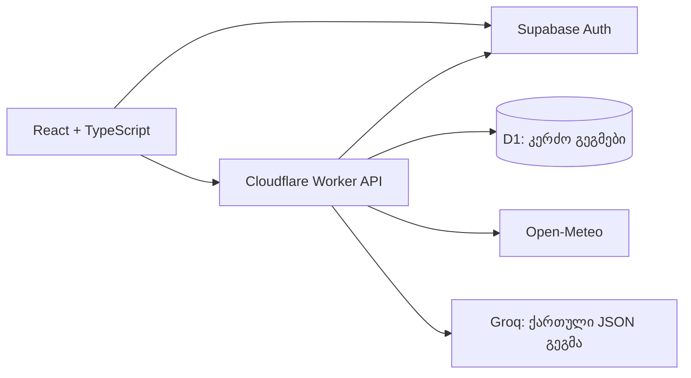

# Holliday Planner — მოქმედი დაგეგმვა

თარიღი: 2026-11-11. მომხმარებლის მოთხოვნით დამატებულია Groq AI და მოგზაურობის სრული საბაზო სცენარი.

## გამოყენება

1. გახსენი https://holliday-planner.dynamicabode1.chatgpt.site და შედი უკვე შექმნილ ანგარიშში.
2. „დაგეგმვაში“ აირჩიე ბაკურიანი, ყაზბეგი ან ბათუმი; მიუთითე გამგზავრების ადგილი, 1–7 დღის ზუსტი თარიღები, ადამიანების რაოდენობა, ტრანსპორტი და ინტერესები.
3. მიუთითე მთელი მოგზაურობის ბიუჯეტი და ერთეული — ერთ ადამიანზე ან მთელ ჯგუფზე. შეჯამება მაშინვე ახლდება.
4. შეინახე მონახაზი ან დააჭირე „შემიდგინე AI გეგმა“. გენერაციამდე მონახაზი ინახება, ამიტომ პროვაიდერის შეცდომა მას არ შლის.
5. მიიღე ქართული დღის გეგმა, ხელმისაწვდომი ამინდი, ბიუჯეტის რჩევა, თან წასაღები ნივთები და ალტერნატივები.
6. ჩამოტვირთე ტექსტური გეგმა, მონიშნე დაგეგმილად/დასრულებულად ან გახსენი „ჩემი გეგმები“. იქ შეგიძლია გეგმის შეცვლა და წაშლაც.

პირობების შეცვლა აუქმებს ძველი AI რჩევის მიმდინარე ვერსიასთან შესაბამისობას. ახალი რჩევისთვის გენერაცია ხელახლა სრულდება. სხვა მიმართულების არჩევისას ამინდიც ცალკე მოწმდება.

## ტექნიკური სტრუქტურა

`server/api.ts` ყოველი პირადი მოთხოვნისას გადაამოწმებს Supabase Bearer სესიას. SQL მოთხოვნებში მფლობელი განისაზღვრება მხოლოდ გადამოწმებული სესიიდან. მომხმარებლის მიერ გამოგზავნილი მფლობელის ID არ გამოიყენება. კლიენტი D1-ს პირდაპირ ვერ უკავშირდება.

## API

| მისამართი | მოქმედება |
| --- | --- |
| `GET /api/config` | სერვისების მზადყოფნის ორი boolean; გასაღებები არ ბრუნდება |
| `GET /api/trips` | მიმდინარე მომხმარებლის ბოლო 50 გეგმა |
| `POST /api/trips` | ახალი მონახაზი ან არსებული გეგმის პირობების შენახვა |
| `POST /api/trips/:id/generate` | შესაბამისი ვერსიის ამინდი და Groq-ის რეალური შეფასება |
| `PATCH /api/trips/:id` | სტატუსის აშკარა ცვლილება |
| `DELETE /api/trips/:id` | საკუთარი გეგმის წაშლა |

გენერაცია იყენებს უნიკალურ მოთხოვნის ID-ს. უკვე შესრულებული მოთხოვნის გამეორება მეორე AI ზარს არ ქმნის. მონაცემთა ბაზაში მოწმდება დღეში 10 მოთხოვნა ერთ მომხმარებელზე, მინიმუმ 20 წამი მოთხოვნებს შორის და საერთო 100 მოთხოვნა 24 საათში. Groq-ის ანგარიშის საკუთარი ლიმიტიც დამატებით მოქმედებს. ვერსიის შემოწმება იცავს გეგმის შეცვლის შემდეგ დაგვიანებული AI პასუხის ჩაწერისგან.

## კონფიგურაცია

ბრაუზერისთვის საჯარო პარამეტრებია `VITE_SUPABASE_URL` და `VITE_SUPABASE_PUBLISHABLE_KEY`.

სერვერის გარემოს პარამეტრებია `SUPABASE_URL`, `SUPABASE_PUBLISHABLE_KEY`, `GROQ_API_KEY` (secret) და `GROQ_MODEL=qwen/qwen3.8-27b`. Groq-ის გასაღები ბრაუზერში, `.openai/hosting.json`-ში ან Git-ში არ ინახება.

D1 binding არის `DB`. სქემაა `db/schema.ts`; პირველი მიგრაცია გენერირებულია `npm.cmd run db:generate` ბრძანებით და ინახება `drizzle/`-ში. ცხრილები request-ის შესრულებისას არ იქმნება. ჰოსტინგი მიგრაციებს განთავსებისას ასრულებს; ლოკალური სერვერი — დაწყებისას ცალკე SQLite ბაზაში.

## მონაცემების მნიშვნელობა

- ბიუჯეტის კატეგორიები გამოითვლება კოდით მომხმარებლის ლიმიტებიდან; ეს ფასების ბაზა ან რეალური შეთავაზებები არ არის. ერთდღიან მოგზაურობაზე საცხოვრებლის წილი ნულია.
- პროგნოზი გამოიყენება მხოლოდ Open-Meteo-ს მიერ დაბრუნებული დღეებისთვის. შორეულ ან ნაწილობრივ დაფარულ თარიღებზე ჩანს უცნობი დღეების შეზღუდვა. ისტორიული ამინდი ამ ვერსიაში არ გამოიყენება.
- Groq იღებს მოგზაურობის პირობებს და არა ანგარიშის ელფოსტას. AI ტექსტი HTML-ად არ სრულდება; React მას ჩვეულებრივ ტექსტად აჩვენებს.
- გამოყენებულია Groq-ის სტრუქტურირებული JSON პასუხი და სერვერის დამატებითი შემოწმება. არასრული ან არასწორი პასუხი შენახულ რჩევად არ გამოისახება.
- გეგმა არ ქმნის ჯავშანს და არ გზავნის მოწვევებს. მომზადებული ტექსტი მომხმარებელს შეუძლია თავად გააზიაროს.

## შემოწმება

- 34 ავტომატური ტესტი: ანგარიშები, ნავიგაცია, ვალიდაცია, ბიუჯეტი, მფლობელთა იზოლაცია, შენახვა, ვერსიები, ლიმიტები, შეცდომები და გასვლა.
- Groq-ისა და Open-Meteo-ს რეალური სატესტო მოთხოვნა: `evidence/P2.9-groq-live.json`. გამოყენებულია გამოგონილი მოგზაურობის პირობები და არა მომხმარებლის კერძო გეგმა.
- რეალურ ბრაუზერში შემოწმებულია ფორმა, ბიუჯეტის ერთეული, სტუმრის შეზღუდვა და განლაგება 320/390/768/1440 სიგანეებზე.
- ავტორიზებული API ტესტები იყენებს სატესტო Auth პასუხს და ნამდვილ SQLite სქემას. ეს არ წარმოადგენს მომხმარებლის პაროლით რეალური ბრაუზერული შესვლის მტკიცებულებას.
- რეალურ შესულ ანგარიშში გენერაციის წარმატება და ორი შენახული გეგმა ბრაუზერში დაფიქსირდა. სატესტო პირობების და AI პასუხის შენახვა D1-შიც დადასტურდა: `evidence/P2.9-ai-signed-in.json`. საბოლოო reload და AI სქრინშოთი ავტომატური მართვის შეზღუდვის გამო არ დასრულებულა.
- საჯარო საიტის ამ ცდაში ამინდი მიუწვდომელი იყო. მოთხოვნის სათაურებისა და დიაგნოსტიკის შემდგომი ცვლილების შემდეგ ავტორიზებული ამინდის ცდა ამ სესიაში ხელახლა არ შესრულებულა.

წყაროები: [Groq მოდელები](https://console.groq.com/docs/models), [სტრუქტურირებული პასუხები](https://console.groq.com/docs/structured-outputs), [ლიმიტები](https://console.groq.com/docs/rate-limits), [Open-Meteo](https://open-meteo.com/en/docs).
